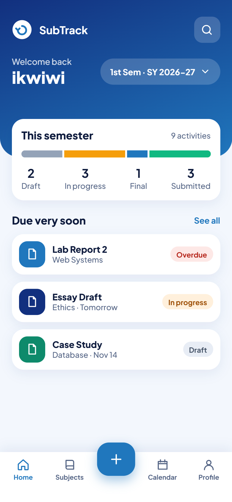

# SubTrack

**"Git for school work" for Android.** Students organise each term into
**semesters → subjects → activities → files**, and every save becomes an
immutable **commit** they can browse, open, and restore from — the same
version-control mental model, applied to coursework instead of code.

- **Offline-first.** After the first sign-in the app works with no internet;
  the cloud is a manual backup only.
- **Restore is non-destructive.** Restoring an old version creates a *new*
  commit that copies it. Nothing is ever deleted or rewritten.
- **Editing happens in external apps** (Word, WPS, …). SubTrack copies the file
  out, hands it to the editor through a `FileProvider`, detects the change when
  the student returns, and saves it as the next version.

| Home | Version history |
|---|---|
|  |  |

More screens are in [`redesign/png/`](redesign/png).

## Features

- **Login** with a username and password; the session is saved locally, so the
  app opens offline afterwards.
- **Semesters, subjects, activities, and files** with deadlines, status
  (draft / in progress / final / submitted), and search across the semester.
- **Per-subject file manager.** Each subject is a workspace with three tabs —
  **Lessons**, **Flashcards**, and **Activities**. Lessons are versioned
  folders with their own files and history; activities keep the status and
  deadline flow.
- **Version history and restore** for every file, plus *Commit new version*
  and *Edit in external app*. Commits store a SHA-256 hash, size, message, and
  whether they came from an upload, an edit, or a restore.
- **Flashcards** (local only): manual decks, import from an external AI via a
  copy-ready prompt with a strict JSON contract, and a flip-card study mode.
  Decks ship in the local `.zip` backup and are never sent to the cloud.
- **Calendar** with deadlines and standalone events, **deadline reminders**,
  **light/dark theme with accent colours**, and a **local ZIP backup/restore**.
- **Manual cloud backup** (Supabase free tier, 100 MB per account) with
  *Back up now* and *Restore from cloud*. Row Level Security keeps every
  account's rows and files private.

## Navigation

Bottom bar: **Home**, a large centre **Menu** button, and **Cloud**.
The menu sheet opens **Subjects**, **Calendar**, **Profile**, **Flashcards**,
and **File manager**.

## Tech stack

| Layer | Choice |
|---|---|
| UI | Flutter (Material 3, Android only) |
| State | `flutter_riverpod` |
| Routing | `go_router` |
| Local database | `drift` (SQLite), one DB file per user id |
| Blob storage | SHA-256 content-addressed files on disk (deduplicated) |
| Auth + cloud | `supabase_flutter`, keys passed only through `--dart-define` |
| Notifications | `flutter_local_notifications` + `timezone` |
| Backup | `archive` (`.zip`) + `share_plus` |

```
lib/
  app/         app widget, router, theme, navigation shell
  core/        hashing, mime, date and avatar helpers
  data/        drift database, repositories, blob store
  features/    auth, dashboard, semesters, subjects, activities, files,
               history, edit, flashcards, search, reminders, backup, cloud, profile
  shared/      reusable widgets
test/          unit and widget tests
docs/          Supabase schema scripts, feature docs, AI import prompt
redesign/png/  13 phone mockups (the design source for the current UI)
```

## Getting started

Full setup — including the one secret step (Supabase keys) — is in
[`DEVELOPING.md`](DEVELOPING.md). Short version:

```bash
git clone https://github.com/eequen/SubTrack.git
cd SubTrack
git switch develop
flutter pub get
flutter run --dart-define-from-file=config.json
```

No cloud values yet? Run the UI with `--dart-define=USE_FAKE_AUTH=true`
(any username/password works, no network).

**No keys live in this repository.** `config.json` is gitignored; only
`docs/config.example.json` with placeholders is tracked, and the real values
enter the binary exclusively via `--dart-define`.

## Testing

```bash
dart format .
flutter analyze
flutter test
```

All three must be clean before every commit (see [`AGENTS.md`](AGENTS.md)).

## Documentation

- [`AGENTS.md`](AGENTS.md) — project scope, hard constraints, data model, and
  the phase-by-phase plan this app was built from.
- [`DEVELOPING.md`](DEVELOPING.md) — local setup and git workflow.
- [`docs/flashcards_ai_import.md`](docs/flashcards_ai_import.md) — how the
  "bring your own AI" flashcard import works.
- [`docs/supabase_schema*.sql`](docs) — cloud schema and migrations, applied
  by the project owner in the Supabase dashboard.

## Status and license

Coursework project by a team of three; features are frozen and only bug fixes
are accepted. The repository is published for review and analysis — no
open-source license is granted, so reuse or redistribution needs the authors'
permission.
